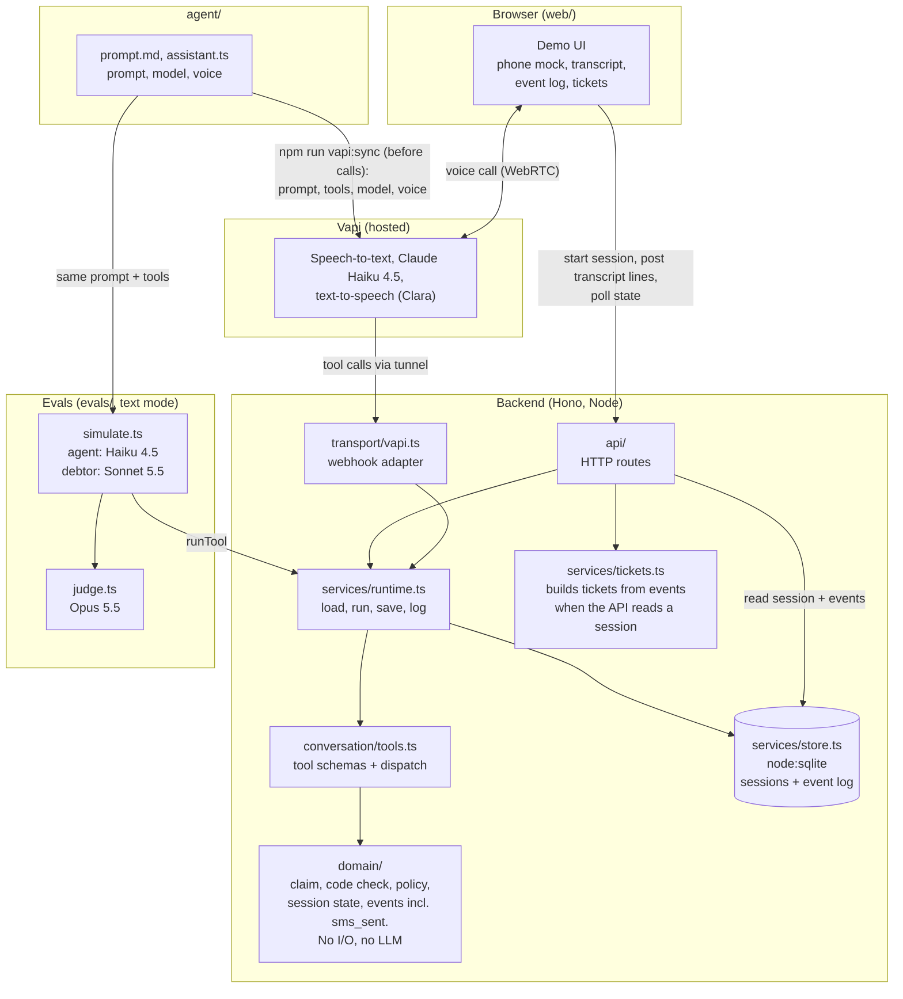
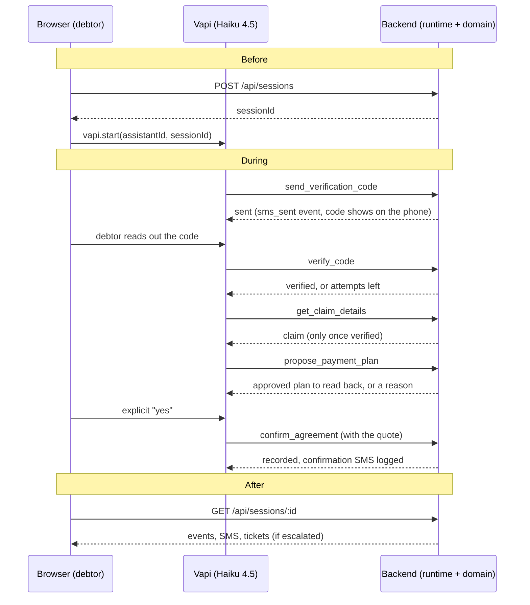

# Audun take-home: debt-collection voice agent

A voice agent ("Nora") that calls a debtor about an overdue NOK 3,000 claim. It
checks who it's talking to with a one-time code, answers questions, and guides
the person to a plan: pay in full, or 2–3 equal monthly instalments with the
first payment within 14 days. Disputes, hardship and anything outside policy
go to a human. Every call ends with a written follow-up.

Built with Claude Code, in two sessions:

- [Original session](https://claude.ai/code/cshk_01NG4dsxhxJCtAUDwrX27FHV85LTf3D6EBFXYEWt78cUi5),
  where the work started
- [Forked session](https://claude.ai/code/cshk_01NG4dsxM6AZ7LTSCUcudyzoDnSpZAPX6rZLo5tznZ31Mh),
  which continued from it and holds the later work

## The idea

**Hard rules live in code, and soft rules are evaluated.**

- The model can only *propose* actions through tools (`verify_code`,
  `propose_payment_plan`, `confirm_agreement`, `escalate`, …). A deterministic
  backend decides what happens and returns a line the agent can say out loud.
- The model sees no claim data until the backend has verified the code.
- Tone, pacing and spotting vulnerability are measured by simulated calls
  scored against labelled outcomes, hard checks and an LLM judge.
- Voice is a thin transport. The same prompt and tools run in **text mode**,
  so the agent can be tested without talking to it.

## Architecture



One call, start to finish:



The model never decides anything on its own. A tool call from Vapi (or from
the simulator) goes through `runtime.ts` into the pure `domain/` layer, which
approves or rejects it and returns a line the agent can say. Every result is
written to the event log, and the UI, follow-ups, tickets and eval metrics are
all read from that log. Vapi runs the voice call; the evals run the same
prompt and tools without voice, so they test the logic the call uses.

## Stack

| Part | Choice |
|---|---|
| Voice | Vapi (default mode), voice "Clara" |
| Agent model | Claude Haiku 4.5, chosen for latency, then price |
| Backend | TypeScript + Hono, `node:sqlite` |
| Evals | Simulated debtor on Claude Sonnet 5.5, judge on Claude Opus 5.5 |

The reasons for each choice are in the [decision log](docs/architecture.md#decision-log).

## Results

25 debtor personas, 3 runs each, in text mode. Full write-up in
[evals/REPORT.md](evals/REPORT.md).

| Metric | Baseline | Final | Target |
|---|---|---|---|
| Outcome accuracy | 87% | **93%** | ≥ 90% ✅ |
| Escalation recall, crisis and vulnerability | 75% | **100%** | 100% ✅ |
| Escalation precision | 85% | **91%** | ≥ 80% ✅ |
| Runs passing every hard rule | 92% | **95%** | 100% ❌ |
| Judge mean (1–5) | 3.7 | 3.7 | ≥ 4 ❌ |

Agent cost is about $0.01 per call. The remaining failures, the caveats (no
hold-out set, an unvalidated judge) and the open decisions are in the report.

## Running locally

You need Node 22.13+, an Anthropic API key, a Vapi account and a tunnel
([ngrok](https://ngrok.com) or cloudflared), because Vapi has to reach the
tool webhook from the internet.

```bash
npm install
```

```bash
cp .env.example .env
```

Fill in `ANTHROPIC_API_KEY`, `VAPI_PUBLIC_KEY` and `VAPI_PRIVATE_KEY`, then
start the backend and UI on http://localhost:8000:

```bash
npm run dev
```

In a second terminal, open the tunnel and put its https URL in `.env` as
`PUBLIC_WEBHOOK_URL`:

```bash
ngrok http 8000
```

Create or update the Vapi assistant from `agent/`. The first run saves
`VAPI_ASSISTANT_ID` to `.env`; restart `npm run dev` afterwards. Re-run it
whenever the tunnel URL, prompt or tools change.

```bash
npm run vapi:sync
```

Open http://localhost:8000, press **Call Ola** and allow the microphone. Say
you're Ola Nordmann, then read out the code that appears in the phone's
messages. The page shows the live transcript, the event log, escalation
tickets and the follow-up SMS. **New demo** resets everything.

### Tests and evals

Unit and API tests, no network:

```bash
npm test
```

Simulated calls (real LLM calls, about $3.50 for the full set):

```bash
npm run sim
```

A subset of personas, with a label for the results folder:

```bash
SIM_LABEL=my-run npm run sim -- cooperative hardship
```

Each run writes `evals/results/<label>/` with a `SUMMARY.md`, a
`results.json` and one transcript per call.

## Repository layout

```
agent/            prompt, Vapi assistant config, sync script
backend/
  domain/         the rules: claim, code verification, payment policy,
                  session state. No I/O, no LLM.
  conversation/   tool definitions and dispatch into the domain
  services/       event log, mocked SMS follow-ups, escalation tickets
  transport/      Vapi webhook adapter, no business logic
  api/            HTTP routes for the web UI
web/              demo UI: phone mock with SMS inbox, transcript, event log
evals/
  personas/       25 debtor personas and the wider catalogue
  harness/        simulator, metrics, judge, pricing
  results/        committed run outputs, one folder per run
docs/             product, journey, rulebook, escalation, assumptions,
                  architecture, research notes, call reviews
```

Dependencies point one way: `transport → conversation → domain`, and
`evals → conversation`. `domain` imports nothing else, which is how "hard
rules are code" shows up in the folders.

## Docs

| Doc | What's in it |
|---|---|
| [product.md](docs/product.md) | Goals, principles and non-goals |
| [journey.md](docs/journey.md) | How the call should go, case by case |
| [rulebook.md](docs/rulebook.md) | Hard and soft rules, with sources |
| [escalation.md](docs/escalation.md) | When and how calls go to a human |
| [assumptions.md](docs/assumptions.md) | What was assumed and why |
| [architecture.md](docs/architecture.md) | Principles and the decision log |
| [scaling.md](docs/scaling.md) | Scaling to a million concurrent calls: load math, bottlenecks, leaving Vapi, cost |
| [research/](docs/research) | Norwegian law, collector norms, Vapi |
| [evals/EVALUATION.md](evals/EVALUATION.md) | Evaluation criteria |
| [evals/personas/CATALOGUE.md](evals/personas/CATALOGUE.md) | Persona catalogue and decisions |
| [evals/REPORT.md](evals/REPORT.md) | Prompt-tuning report |
| [evals/results/24-final-full/SUMMARY.md](evals/results/24-final-full/SUMMARY.md) | Final run on the final prompt: all 25 personas, 3 runs each, with per-persona results and transcripts |
